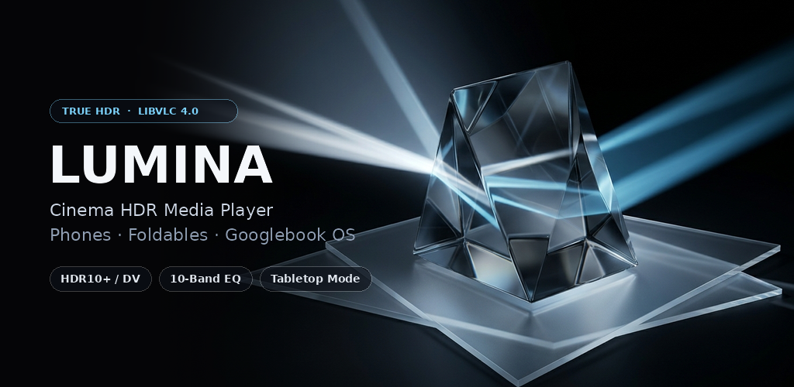
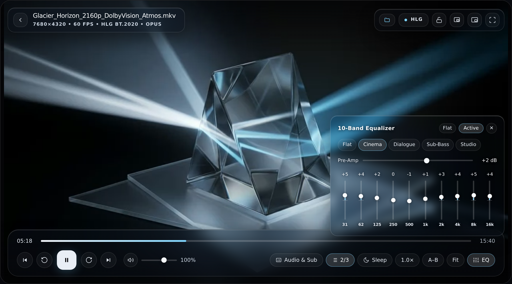
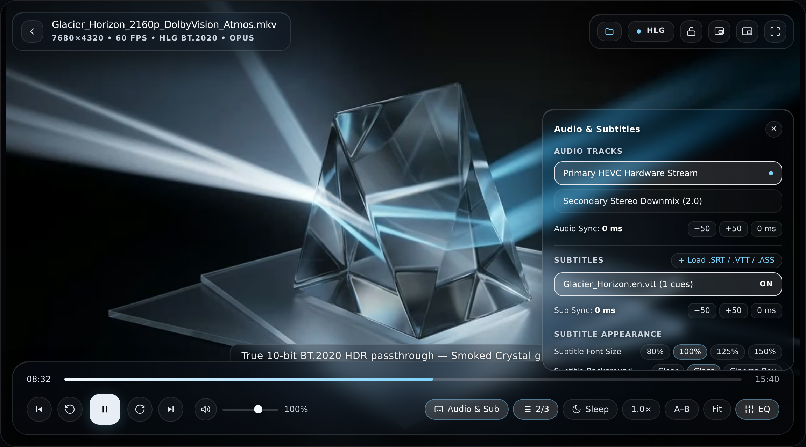
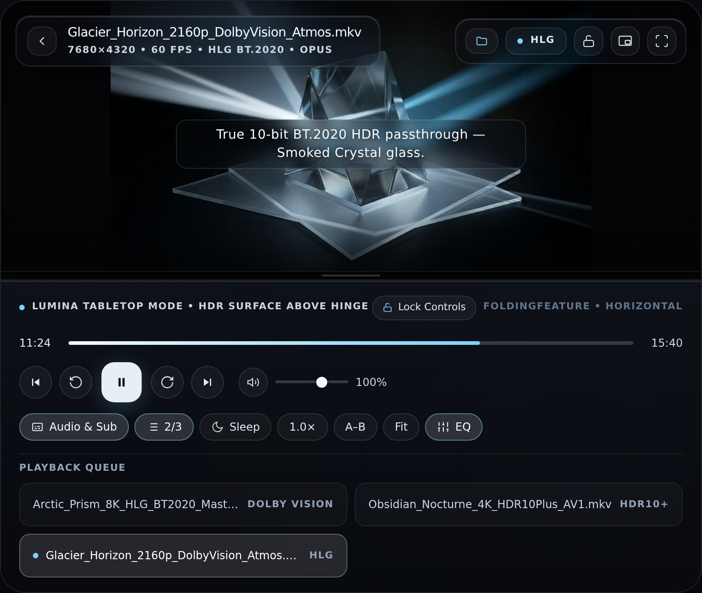
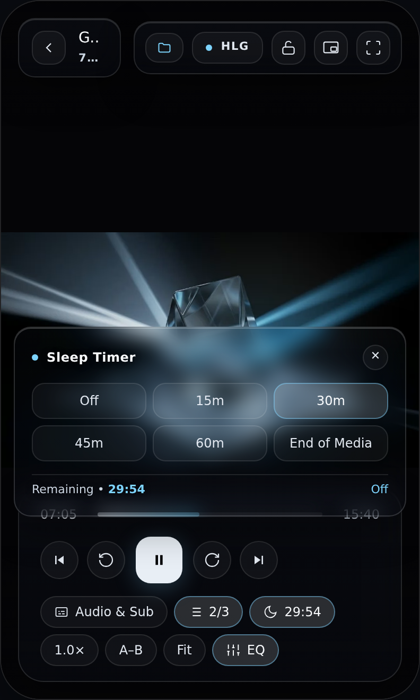
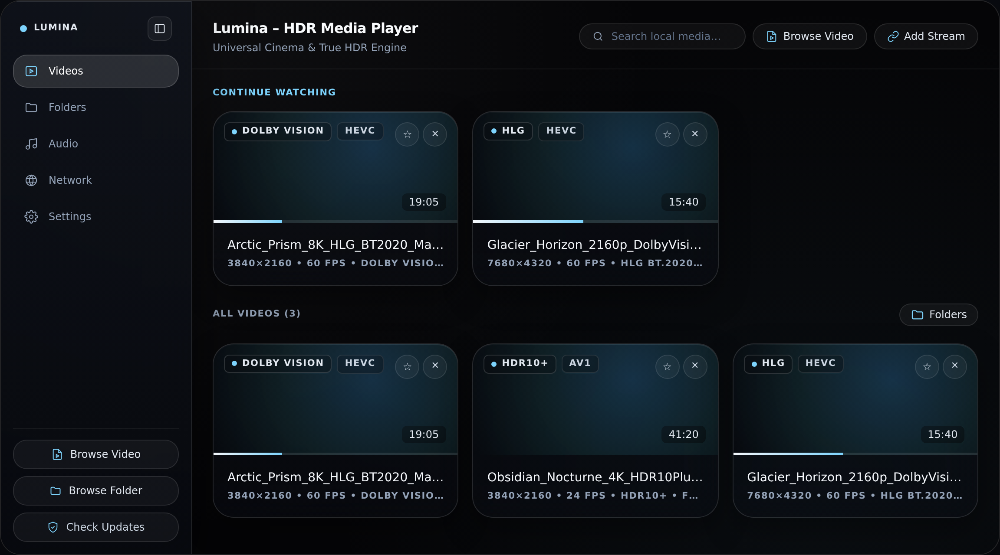
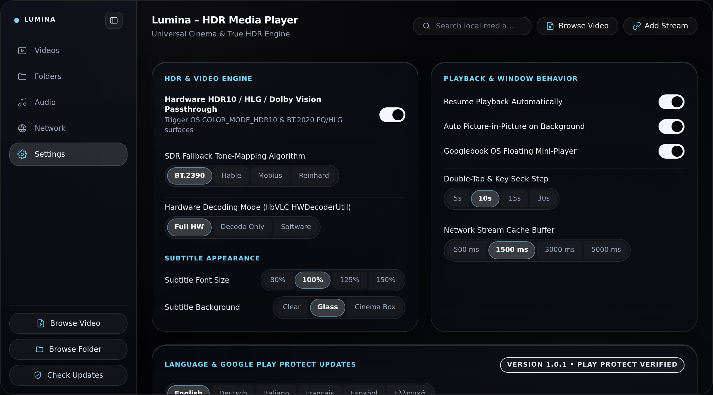

<div align="center">



<br />

# Lumina — HDR Media Player

**Universal Cinema & True HDR10 / HLG / Dolby Vision Media Player for Android Smartphones, Foldables & Googlebook OS**

[](https://github.com/petrosvassiliou/lumina/actions/workflows/android-ci.yml)
[](https://github.com/petrosvassiliou/lumina/releases/latest)
[-38BDF8)](https://github.com/petrosvassiliou/lumina/releases/latest)
[](https://code.videolan.org/videolan/libvlc-android)
[](PLAY_STORE_PUBLISHING.md)

</div>

---

**Lumina** (`app.lumina.player`) is a universal, hardware-accelerated HDR media player engineered with **Material 3 Expressive** (*"OLED Smoked Crystal"*) aesthetics and powered by **VideoLAN libVLC 4.0** (`org.videolan.android:libvlc-all:4.0.0-eap29`).

Designed from the ground up for **Android Smartphones**, **Foldables**, and **Googlebook OS** (desktop/laptop multi-window Android environments), Lumina delivers true wide-color HDR10 / HLG / Dolby Vision playback, lossless 10-band biquad audio processing, local Scoped Storage & SAF folder browsing, and LAN/NAS streaming — with **zero ads, zero telemetry, and 100% Google Play Protect compliance**.

---

## Downloads

Grab the latest signed APKs directly from **[GitHub Releases (`v1.0.1`)](https://github.com/petrosvassiliou/lumina/releases/latest)**:

| Package | Target Devices | Notes |
| :--- | :--- | :--- |
| **`lumina-v1.0.1-arm64-v8a.apk`** | Modern Android Smartphones, Foldables & Tablets (64-bit ARM) | **Recommended** for almost all phones & tablets |
| **`lumina-v1.0.1-x86_64.apk`** | **Googlebook OS** Laptops, Desktops & ChromeOS/PC Emulators | Native 64-bit Intel / AMD hardware decoding |
| **`lumina-v1.0.1-armeabi-v7a.apk`** | Legacy 32-bit ARM Android TVs & Older Devices | Lightweight 32-bit ARM build |
| **`lumina-v1.0.1-universal.apk`** | All Architectures (`arm64-v8a`, `armeabi-v7a`, `x86_64`, `x86`) | Single multi-ABI installer |
| **`lumina-v1.0.1-playstore-unsigned.aab`** | Google Play Console App Signing | R8-optimized Android App Bundle |

---

## Screenshots

### Googlebook OS & Desktop Cinema HUD — 10-Band Hardware Equalizer

*Unobstructed HDR10/BT.2020 video surface with sheer Smoked Crystal floating popovers (`Cinema` 10-band biquad EQ + `150%` hardware gain boost) — zero full-screen scrims.*

### Live Glass Subtitles, Audio/Sub Sync & HDR Pipeline

*External `.srt` / `.vtt` / `.ass` / `.ssa` subtitle loading via SAF, live `±50 ms` audio & subtitle sync controls, configurable font scale, and translucent Glass caption pills.*

### Adaptive Multi-Posture: Foldable Tabletop Mode & Smartphone Portrait
| **Foldable Tabletop Mode (`FoldingFeature`)** | **Smartphone Portrait + Sleep Timer** |
| :---: | :---: |
|  |  |
| *Automatically pins unobstructed HDR video above the physical hinge crease and places transport controls + Up Next queue on the lower deck.* | *One-handed edge-to-edge OLED layout with vertical brightness/volume gestures, Cinema Touch Lock, and live Sleep Timer.* |

### Adaptive HDR Media Library & Material 3 Expressive Settings
| **HDR Format Cards & Local SAF Folder Browser** | **Material 3 Expressive Settings & Play Protect Updates** |
| :---: | :---: |
|  |  |
| *Scoped Storage MediaStore indexing + recursive `OpenDocumentTree` folder mounting with Dolby Vision / HDR10+ / HLG / AV1 / HEVC badges.* | *Hardware HDR passthrough, libVLC 4.0 SDR tone-mapping curves (`BT.2390`, `Hable`, `Mobius`, `Reinhard`), 6 languages, and Google Play Protect updates.* |

---

## Key Capabilities

### 1. Universal Cinema & True HDR Pipeline
- **Hardware-Accelerated libVLC 4.0 Engine:** Fault-tolerant asynchronous native decoding across `arm64-v8a`, `armeabi-v7a`, `x86_64`, and `x86` for MKV, MP4, WebM, MOV, AVI, TS/M2TS, FLAC, ALAC, WAV, Opus, and Ogg.
- **Wide-Color Gamut & HDR Passthrough:** Requests `ActivityInfo.COLOR_MODE_HDR10` (`BT.2020 PQ` / `BT.2020 HLG`) and extended HDR headroom on capable displays, with configurable libVLC 4.0 OpenGL/libplacebo SDR tone-mapping fallback (`ITU-R BT.2390 EETF`, `Hable`, `Mobius`, `Reinhard`).
- **Live Pipeline Inspector:** Non-blocking sheer popover inspecting active `ColorSpace`, transfer function, hardware decoder mode (`FULL`, `DECODE`, `SW`), and video dimensions.

### 2. Adaptive Multi-Posture Architecture
- **Googlebook OS Desktop Mode:** Freeform multi-window resizing, pointer hover states, right-click context menu, hardware keyboard shortcuts, and an Always-on-Top floating mini-player.
- **Foldable Tabletop Mode (`FoldingFeature`):** Automatically detects half-opened horizontal hinge postures, pinning the unobstructed HDR video surface above the hinge crease and placing transport controls + playback queue on the lower deck.
- **Smartphone Cinema Mode:** Edge-to-edge OLED layout with vertical brightness/volume swipe gestures, double-tap seek, and automatic Android 12+ seamless Picture-in-Picture (`setAutoEnterEnabled`).

### 3. Material 3 Expressive "OLED Smoked Crystal" Design
- **Strictly Zero Yellow Palette:** Pure OLED black (`#050507`), neutral smoked crystal glass (`18%–30%` alpha popovers with zero full-screen scrims), Moonlight Platinum (`#F4F7FB`), Glacier Ice (`#7DD3FC`), and muted rose (`#FB7185`) for error recovery.
- **Android 13–15 Themed `<monochrome>` Adaptive Icon:** Full support for Material You launcher icon tinting (`ic_launcher_monochrome.xml`).
- **Non-Intrusive Cinema Controls:** Audio tracks, subtitles, chapters, sleep timer, playback speed, and the 10-band equalizer open as compact, translucent floating popovers without pausing or obscuring active playback.

### 4. Cinema Power-User Suite
- **Cinema Touch Lock (`L`):** Locks all HUD bars, gestures, and transport keys behind a sheer floating *"Tap to Unlock Controls"* pill to prevent accidental touches.
- **MKV / MP4 Chapter Selector (`[` / `]`):** Reads embedded chapters directly from `MediaPlayer.getChapters(-1)` for instant chapter jumping (with an honest empty state when no chapters are embedded).
- **Sleep Timer:** Auto-pauses playback after `15m`, `30m`, `45m`, `60m`, or at `End of Media` with a live countdown badge.
- **Live Subtitle Styling & Sync:** External `.srt` / `.vtt` / `.ass` / `.ssa` loader via SAF, `±50 ms` subtitle/audio sync offsets, configurable font scale (`80%`, `100%`, `125%`, `150%`), and background style (`Clear`, `Glass`, `Cinema Box`).
- **10-Band Hardware Equalizer & Volume Boost:** `31 Hz – 16 kHz` biquad equalizer with `±20 dB` bands, pre-amp gain, presets (`Flat`, `Cinema`, `Dialogue`, `Sub-Bass`, `Studio`), and up to `150%` gain boost.
- **Local File System & LAN Streaming:** Scoped Storage MediaStore indexing, recursive SAF folder mounting (`OpenDocumentTree`), sorting & HDR format filtering, plus SMB / FTP / UPnP / DLNA / HLS / RTSP streaming.

### 5. Google Play Protect In-App Updates & Localization
- **Official Play Core In-App Updates:** Supports both automatic background **Flexible Updates** and manual update verification via `com.google.android.play:app-update` — with graceful fallback on sideloaded/non-GMS installations and zero sideloading permissions (`REQUEST_INSTALL_PACKAGES` and `MANAGE_EXTERNAL_STORAGE` are never requested).
- **6 Built-In Languages:** English (`en`), Deutsch (`de`), Italiano (`it`), Français (`fr`), Español (`es`), and Ελληνικά (`el`) via AndroidX Per-App Language Preferences.

---

## Hardware Keyboard Shortcuts (Googlebook OS & External Keyboards)

| Shortcut | Action |
| :--- | :--- |
| `Space` | Play / Pause |
| `←` / `→` | Seek backward / forward by configured step (`5s` / `10s` / `15s` / `30s`) |
| `Shift + ←` / `Shift + →` | Large jump backward / forward (`3×` step) |
| `[` / `]` | Previous / Next embedded MKV/MP4 chapter |
| `↑` / `↓` | Volume Up / Down (`0% – 150%`) |
| `L` | Toggle Cinema Touch Lock (locks/unlocks all controls & gestures) |
| `O` | Browse Local Video Files |
| `V` | Toggle Subtitles / Open Audio & Subtitles popover |
| `A` | Open Audio & Subtitles popover |
| `C` | Cycle Aspect Ratio (`Fit`, `Fill`, `16:9`, `21:9`, `Stretch`) |
| `M` | Toggle Mute |
| `F` | Toggle Fullscreen |
| `Esc` | Dismiss active sheer popover or context menu |

---

## Project Architecture

```text
app/src/main/
├── java/app/lumina/player/
│   ├── data/
│   │   ├── local/          # Room database, MediaDao & entities (favorites, resume positions, streams)
│   │   ├── preferences/    # Jetpack DataStore preferences (HDR, EQ, Subtitle styling, Updates)
│   │   └── repository/     # Scoped Storage MediaStore + SAF DocumentFile directory scanner
│   ├── di/                 # Hilt dependency injection modules
│   ├── domain/model/       # Clean domain models, sort modes & HDR format filters
│   ├── navigation/         # Adaptive WindowSizeClass + FoldingFeature posture detector
│   ├── player/
│   │   ├── engine/         # LuminaPlayerEngine (libVLC 4.0, HDR surface, EQ, Chapters, Sleep Timer)
│   │   ├── hdr/            # LuminaHdrController (COLOR_MODE_HDR10 & VLC 4.0 tone-mapping flags)
│   │   ├── lan/            # LuminaLanDiscoveryManager (UPnP/DLNA & mDNS/NSD LAN discovery)
│   │   ├── model/          # Immutable LuminaPlayerState, ChapterInfo & SleepTimerState
│   │   └── service/        # Foreground MediaSession playback service
│   ├── ui/
│   │   ├── components/     # Smoked Crystal glass surfaces & M3 Expressive controls
│   │   ├── library/        # Adaptive Videos, Folders, Audio, Network & Settings screens
│   │   ├── player/         # Cinema HUD, Tabletop split deck, Googlebook mini-player & popovers
│   │   └── theme/          # Zero-yellow OLED Smoked Crystal color tokens, motion & typography
│   └── update/             # LuminaUpdateManager (Google Play Protect In-App Updates)
└── res/                    # Adaptive monochrome icons, network security config & 6-locale strings
```

---

## Building & Signing

### Prerequisites
- **JDK 17** (Temurin recommended)
- **Android SDK 36** (`compileSdk = 36`, `targetSdk = 35`, `minSdk = 26`)
- **Gradle 8.10.2** (`./gradlew`)

### Debug Build & Unit Tests
```bash
./gradlew testDebugUnitTest lintDebug assembleDebug
```

### Signed Release App Bundle (`.aab`) for Google Play
Configure your upload keystore via environment variables or `gradle.properties` (never commit `.jks` or `.keystore` files):

```bash
export LUMINA_KEYSTORE_PATH="/absolute/path/to/upload-keystore.jks"
export LUMINA_KEYSTORE_PASSWORD="your-store-password"
export LUMINA_KEY_ALIAS="lumina-upload"
export LUMINA_KEY_PASSWORD="your-key-password"

./gradlew bundleRelease
```

The signed Play Store bundle is output to `app/build/outputs/bundle/release/app-release.aab` with APK Signature Schemes v1–v4 and uncompressed page-aligned native libraries enabled. For automated GitHub Releases & Google Play Console Track deployment via Fastlane metadata, see [PLAY_STORE_PUBLISHING.md](PLAY_STORE_PUBLISHING.md).

---

## Privacy & Security
Lumina operates strictly offline and on user-specified local/LAN URIs with zero analytics, zero crash-reporting SDKs, and zero advertising identifiers. See [PRIVACY_POLICY.md](PRIVACY_POLICY.md) for the complete Google Play Data Safety declaration.
