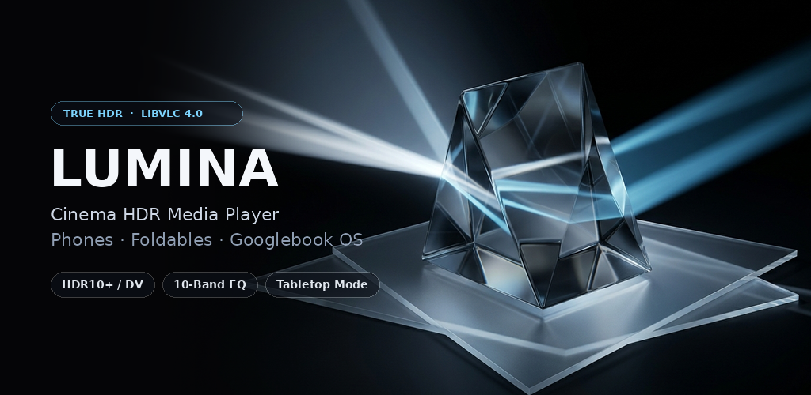
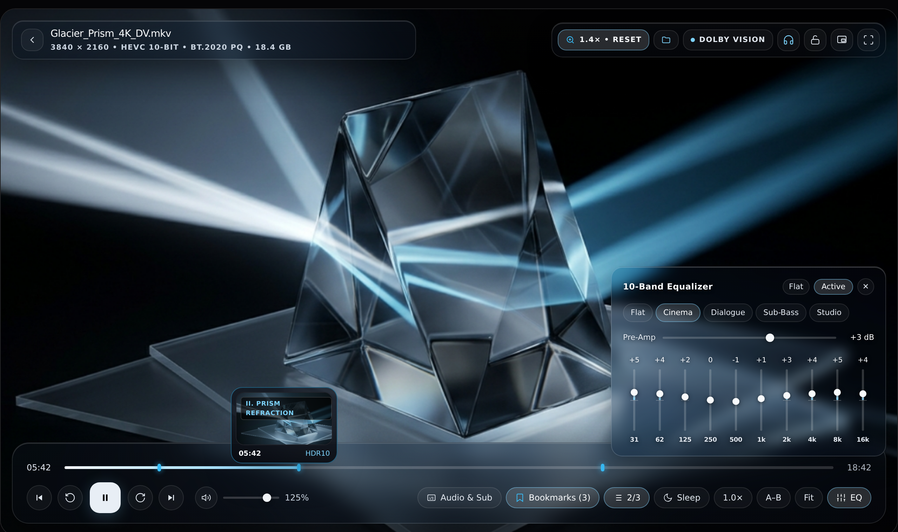
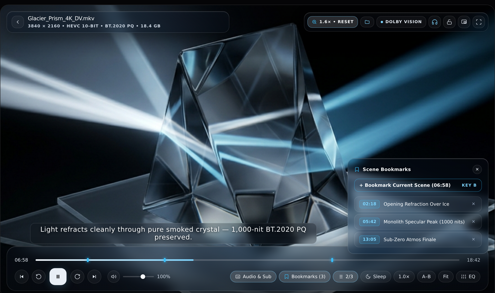
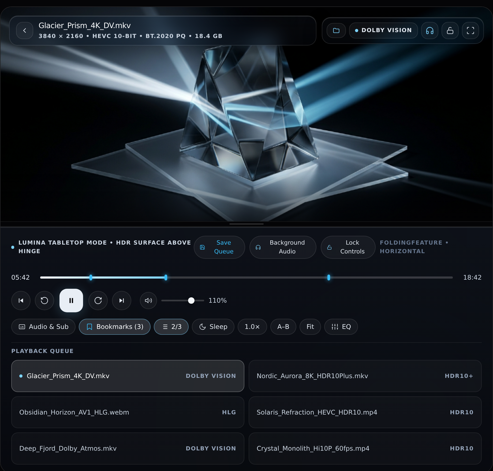
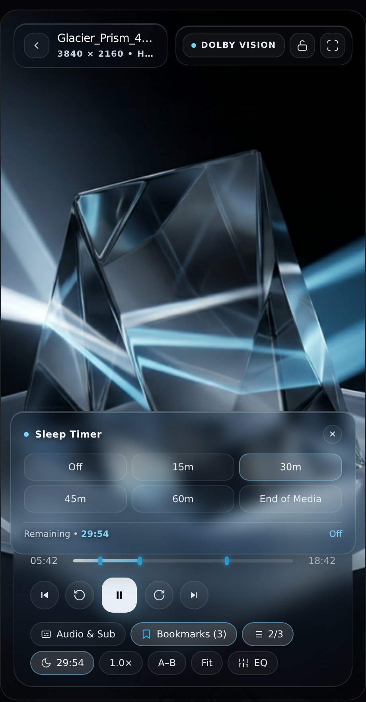
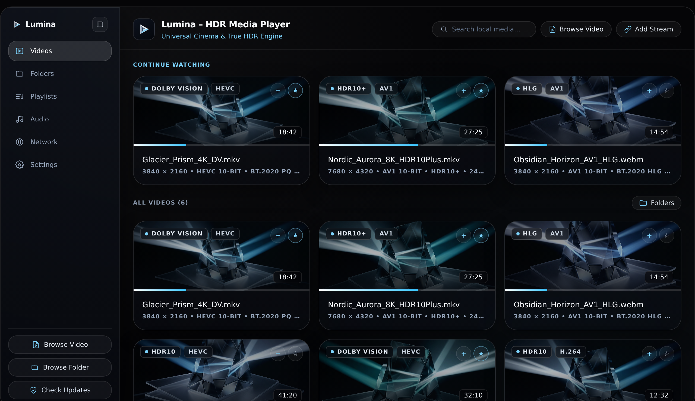
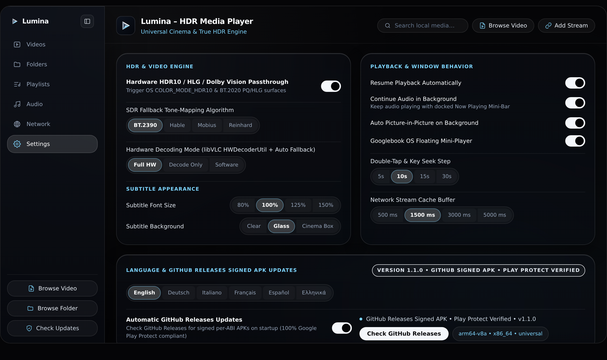
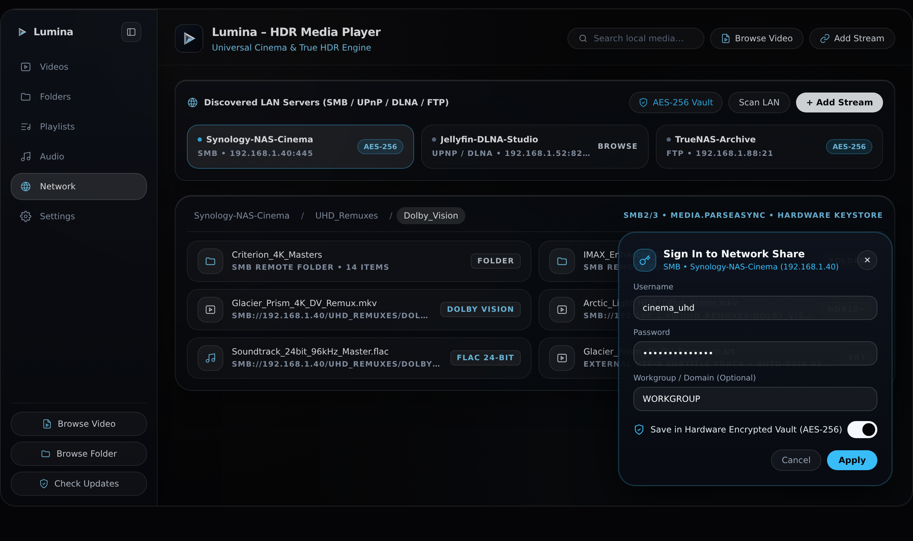
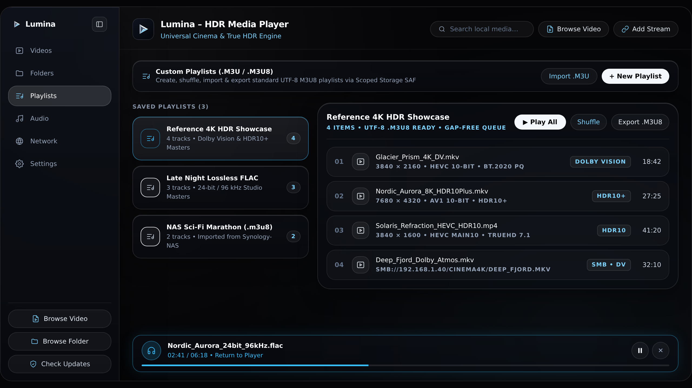

<div align="center">



<br />

# Lumina — HDR Media Player

**Universal Cinema, ADM Multi-Connection Stream Downloader & True HDR10 / HLG / Dolby Vision Media Player for Android Smartphones, Foldables & Googlebook OS**

[](https://github.com/petrosvassiliou/lumina/actions/workflows/android-ci.yml)
[](https://github.com/petrosvassiliou/lumina/releases/latest)
[-38BDF8)](https://github.com/petrosvassiliou/lumina/releases/latest)
[-5EEAD4)](https://github.com/petrosvassiliou/lumina/releases/latest)
[](https://code.videolan.org/videolan/libvlc-android)
[](PRIVACY_POLICY.md)

</div>

---

**Lumina** (`app.lumina.player`) is a universal, hardware-accelerated HDR media player and **ADM-style multi-connection stream downloader** crafted with **Material 3 Expressive** (*"OLED Smoked Crystal"*) design and powered by **VideoLAN libVLC 4.0** (`org.videolan.android:libvlc-all:4.0.0-eap29`).

Built from the ground up for **Android Smartphones**, **Foldables** (**Lumina Tabletop Mode**), and **Googlebook OS** laptops/tablets/desktops, Lumina delivers wide-color HDR10 / HDR10+ / HLG / Dolby Vision playback, up to **16-connection parallel HTTP/HTTPS/FTP & HLS (`.m3u8`) offline stream downloading**, lossless 10-band biquad audio processing, custom `.m3u` / `.m3u8` playlists, recursive local SAF & LAN/NAS share browsing, and direct **GitHub Releases signed APK updates** — with **zero ads, zero telemetry, and 100% Google Play Protect sideloading compliance**.

---

## Downloads (`v1.2.0`)

Download production-signed APKs directly from **[GitHub Releases (`v1.2.0`)](https://github.com/petrosvassiliou/lumina/releases/latest)**. Once installed, Lumina automatically selects the right signed APK for your device via **Settings → Check for Updates**.

| Package | Target Devices | Notes |
| :--- | :--- | :--- |
| **[`Lumina-v1.2.0-googlebook-os.apk`](https://github.com/petrosvassiliou/lumina/releases/download/v1.2.0/Lumina-v1.2.0-googlebook-os.apk)** | **All Googlebook OS Laptops, Detachables & Chromeboxes** (Intel, AMD, MediaTek & Snapdragon) | **Recommended for Googlebook OS** — guaranteed universal installer (`x86_64` + `arm64-v8a` + `armeabi-v7a` + `x86`) |
| **[`Lumina-v1.2.0-arm64-v8a.apk`](https://github.com/petrosvassiliou/lumina/releases/download/v1.2.0/Lumina-v1.2.0-arm64-v8a.apk)** | Modern Android Smartphones, Foldables & Tablets (64-bit ARM) | **Recommended** for almost all Android phones, foldables & tablets |
| **[`Lumina-v1.2.0-x86_64.apk`](https://github.com/petrosvassiliou/lumina/releases/download/v1.2.0/Lumina-v1.2.0-x86_64.apk)** | Compact 64-bit Intel / AMD Systems | Slim `x86_64`-only split |
| **[`Lumina-v1.2.0-universal.apk`](https://github.com/petrosvassiliou/lumina/releases/download/v1.2.0/Lumina-v1.2.0-universal.apk)** | All Architectures (`arm64-v8a`, `armeabi-v7a`, `x86_64`, `x86`) | Universal multi-ABI APK (`versionCode` `102009`) |
| **[`Lumina-v1.2.0-armeabi-v7a.apk`](https://github.com/petrosvassiliou/lumina/releases/download/v1.2.0/Lumina-v1.2.0-armeabi-v7a.apk)** | Legacy 32-bit ARM Android TVs & Older Devices | Compact 32-bit ARM build |
| **[`Lumina-v1.2.0-x86.apk`](https://github.com/petrosvassiliou/lumina/releases/download/v1.2.0/Lumina-v1.2.0-x86.apk)** | Legacy 32-bit Intel / x86 Devices | Compact 32-bit x86 build |
| **[`SHA256SUMS.txt`](https://github.com/petrosvassiliou/lumina/releases/download/v1.2.0/SHA256SUMS.txt)** | Cryptographic Checksums | Verify APK integrity (`v1` + `v2` + `v3` APK signatures) |

### Installing on Googlebook OS (100% Compatibility)

Always download **[`Lumina-v1.2.0-googlebook-os.apk`](https://github.com/petrosvassiliou/lumina/releases/download/v1.2.0/Lumina-v1.2.0-googlebook-os.apk)** so you never have to guess whether your Googlebook OS device uses an Intel/AMD (`x86_64`) or MediaTek/Snapdragon (`arm64-v8a`) processor:

1. **Standard Linux Container ADB Install (No Developer Mode / No Powerwash Required):**
   - Open **Settings → About Googlebook OS / Developers → Linux development environment → Develop Android apps** and enable **Enable ADB debugging** (one-time toggle).
   - Move `Lumina-v1.2.0-googlebook-os.apk` into **Linux files** in the Files app, open **Terminal**, and run:
     ```bash
     sudo apt-get update && sudo apt-get install -y android-tools-adb
     adb install -r Lumina-v1.2.0-googlebook-os.apk
     ```
2. **Direct Double-Click Install from Files App:**
   - On devices with **Developer Mode** or enterprise/managed APK sideloading enabled, simply double-click `Lumina-v1.2.0-googlebook-os.apk` in the **Files** app and confirm **Install**.

---

## What's New in `v1.2.0`

- **ADM-Style Multi-Connection Stream & Media Downloader (`1×`–`16×` Parallel Parts + HLS `.m3u8`):**
  - **Segmented Multi-Threaded `Range` Engine:** Splits HTTP/HTTPS/FTP media files into `1`, `4`, `8`, or `16` concurrent `Range: bytes=start-end` connections writing directly via lock-free positional `FileChannel.write(ByteBuffer, position)` with zero final-merge disk duplication.
  - **Signature Live Multi-Segment Progress Bars:** Real-time per-part progress cells, live transfer speed (`MB/s`), ETA, and crash-safe **Pause / Resume** across app restarts backed by Room v3 (`MIGRATION_2_3`).
  - **HLS `.m3u8` Stream Downloader & Variant Picker:** Probes Master `.m3u8` playlists (`2160p` / `1080p` / `720p` bitrate & resolution selector), downloads `.ts` and fMP4 (`#EXT-X-MAP`) segments in parallel, decrypts standard `AES-128` (`#EXT-X-KEY`) streams on the fly, and exports cleanly to `Downloads/Lumina` via `MediaStore.Downloads` while auto-indexing into your Lumina Video/Audio Library.
  - **Custom HTTP Headers & 1-Tap Entry Points Everywhere:** Configure `Referer`, `User-Agent`, and `Authorization` headers; trigger ADM downloads from the new **Downloads** tab, **Open Network Stream** dialog, saved **Network Streams** cards, the **Player Top HUD** (`D` shortcut or right-click menu while streaming), or **Android / Googlebook Browser Share → Lumina**.
- **Guaranteed Googlebook OS Installation Hardening:**
  - Declared `<uses-feature android:name="android.hardware.wifi" android:required="false" />`, `faketouch`, and `picture_in_picture` as non-required so Chromeboxes, docked Ethernet setups, and ARCVM virtualized `virtio-net` containers never reject installation with `INSTALL_FAILED_MISSING_FEATURE`.
  - Built against stable Android 15 (`compileSdk = 35`), `extractNativeLibs="true"`, `4 KB` page-aligned `zipalign`, explicit `apksigner` **`v1 + v2 + v3`** signatures, and monotonic per-ABI `versionCode`s (`universal` / `googlebook-os` highest at `102009`) so installing or upgrading over any prior split always succeeds.

---

## Previous Highlights (`v1.1.0`)

- **128 MB Persistent Poster Cache & Live 16:9 Scrub Frame Previews:** Extracts representative HDR/SDR poster thumbnails (skipping black `0:00` intro frames) across **Continue Watching**, **All Videos**, and **Folders**, plus a debounced **16:9 Timeline Scrub & Pointer-Hover Frame Preview** bubble above the seek bar.
- **Interactive SMB / UPnP / DLNA / FTP Folder Browser & Hardware AES-256 Vault:** Recursively browse NAS shares and media servers with path breadcrumbs (`Media.parseAsync`), backed by hardware `AndroidKeyStore` `AES-256-GCM` credential persistence (`LuminaCredentialVault`).
- **Custom Playlists (`.m3u` / `.m3u8` Import & Export) + Scene Bookmarks (`B`):** Create, rename, shuffle, import, and export standard UTF-8 `.m3u` / `.m3u8` playlists via SAF, save the active playback queue in one tap, and drop per-video **Scene Bookmarks** with cyan timeline markers.
- **Interactive `1.0×–4.0×` Video Zoom & Pan + Docked Background Audio Mini-Bar:** Pinch-to-zoom on touchscreens/trackpads, `Ctrl + Mouse Wheel`, or `+` / `-` / `0` on Googlebook OS with a one-tap reset pill, plus continuous background audio playback with a Smoked-Crystal **Now Playing Mini-Bar** docked in the library.
- **Hardened Playback Engine & Googlebook OS Windowing (`v1.0.4`–`v1.0.10`):**
  - Automatic 3-tier hardware-to-software decoder fallback (`FULL` → `DECODE` → `SW`) for 10-bit H.264 (`Hi10P`) and non-standard MP4 files so playback never stalls on a blank surface.
  - Deterministic post-EOF timeline scrubbing, `Space` / Play restart from any seek offset, rapid track switching, and crash-free player-to-library surface detachment.

---

## Screenshots

### Googlebook OS & Desktop Cinema HUD — 10-Band EQ, Scrub Preview & Video Zoom

*Unobstructed BT.2020 HDR10 / Dolby Vision stage with live 16:9 timeline scrub frame preview, cyan scene bookmark ticks, `1.4×` zoom reset pill, and sheer Smoked Crystal `Cinema` 10-band biquad EQ — zero full-screen scrims.*

### Per-Video Scene Bookmarks (`B`), Live Glass Subtitles & Zoom Controls

*Mark key scenes with `B`, jump directly from the sheer Scene Bookmarks popover or cyan timeline ticks, and pair external `.srt` / `.vtt` / `.ass` / `.ssa` subtitles with translucent Glass styling.*

### Adaptive Multi-Posture: Foldable Tabletop Mode & Smartphone Portrait
| **Foldable Tabletop Mode (`FoldingFeature`)** | **Smartphone Portrait + Sleep Timer** |
| :---: | :---: |
|  |  |
| *Automatically pins unobstructed HDR video above the physical hinge crease and places transport controls, `Save Queue`, `Background Audio`, and the Playback Queue on the lower deck.* | *One-handed edge-to-edge OLED layout with vertical brightness/volume swipe gestures, Cinema Touch Lock, Scene Bookmarks, and live Sleep Timer.* |

### Adaptive HDR Media Library & Material 3 Expressive Settings
| **Representative HDR Poster Cards & Adaptive Navigation** | **Material 3 Expressive Settings & GitHub APK Updater** |
| :---: | :---: |
|  |  |
| *Persistent 16:9 poster thumbnails across **Continue Watching** and **All Videos**, Dolby Vision / HDR10+ / HLG / AV1 / HEVC format chips, and quick `+` Add-to-Playlist actions.* | *Hardware HDR passthrough, libVLC 4.0 SDR tone-mapping (`BT.2390`, `Hable`, `Mobius`, `Reinhard`), ADM Multi-Connection tuning, 6 languages, and signed GitHub Releases APK updates.* |

### Recursive LAN / NAS Share Browser (`AES-256` Vault) & `.M3U8` Playlists + Mini-Bar
| **SMB / UPnP / DLNA / FTP Browser & Hardware AES-256 Vault** | **Custom `.M3U` / `.M3U8` Playlists & Now Playing Mini-Bar** |
| :---: | :---: |
|  |  |
| *Browse NAS shares recursively with breadcrumbs and persist SMB / FTP credentials inside Android's hardware-backed `AES-256-GCM` Keystore vault.* | *Manage, shuffle, import, and export UTF-8 `.m3u` / `.m3u8` playlists while background audio continues in the docked Smoked-Crystal Now Playing Mini-Bar.* |

---

## Key Capabilities

### 1. ADM-Style Multi-Connection Stream & Media Downloader
- **Up to `16×` Parallel Byte-Range Connections:** Accelerates HTTP/HTTPS/FTP video & audio downloads with independent `Range` workers, positional `FileChannel` writes, live multi-cell segment bars, and Room-backed Pause/Resume.
- **HLS `.m3u8` Master Variant Selection & Segment Merger:** Parses Master `.m3u8` streams to pick exact resolution/bitrate variants, downloads `.ts` and fMP4 (`#EXT-X-MAP`) chunks concurrently, supports standard `AES-128` segment decryption, and saves finished media directly into `Downloads/Lumina` + Lumina's local library.

### 2. Universal Cinema & Fault-Tolerant True HDR Pipeline
- **libVLC 4.0 Native Decoding:** Asynchronous hardware-accelerated playback across `arm64-v8a`, `x86_64`, `armeabi-v7a`, and `x86` for MKV, MP4, WebM, MOV, AVI, TS/M2TS, FLAC, ALAC, WAV, Opus, Ogg, and MP3.
- **Automatic Hardware-to-Software Fallback:** Detects stalled video frames on unsupported 10-bit H.264 (`Hi10P`) or exotic MP4 profiles and seamlessly cascades from `FULL` hardware decoding to `DECODE` and `SW` while preserving current playback position.
- **Wide-Color Gamut & HDR Passthrough:** Activates `ActivityInfo.COLOR_MODE_HDR10` (`BT.2020 PQ` / `BT.2020 HLG`) on capable displays, with configurable libVLC 4.0 OpenGL/libplacebo SDR tone-mapping fallback (`ITU-R BT.2390 EETF`, `Hable`, `Mobius`, `Reinhard`) and a live **HDR Pipeline Inspector** popover.

### 3. Adaptive Multi-Posture Architecture & Googlebook OS Power Suite
- **Googlebook OS Desktop Mode:** Guaranteed multi-ABI installation (`Lumina-v1.2.0-googlebook-os.apk`), true freeform window fullscreen (`F` or HUD button), cross-app **Drag-and-Drop**, interactive **`1.0×–4.0×` Video Zoom & Pan**, pointer-hover timeline frame previews, right-click context menu, full hardware keyboard shortcuts, and an Always-on-Top floating mini-player.
- **Foldable Tabletop Mode (`FoldingFeature`):** Automatically detects half-opened horizontal hinge postures via Jetpack WindowManager, pinning the unobstructed HDR video surface above the hinge crease and placing transport controls + queue actions below.
- **Smartphone Cinema Mode:** Edge-to-edge OLED layout with left-edge brightness and right-edge volume swipe gestures, two-finger pinch-to-zoom & pan, double-tap seek, Cinema Touch Lock (`L`), and seamless Android 12+ Picture-in-Picture (`setAutoEnterEnabled`).

### 4. Material 3 Expressive "OLED Smoked Crystal" Aesthetics
- **Strictly Zero Yellow Palette:** Pure OLED black (`#050507`), neutral smoked crystal glass (`18%–30%` alpha floating popovers with zero full-screen scrims), Moonlight Platinum (`#E8EEF5`), Glacier Cyan (`#7DD3FC` / `#BAE6FD`), Teal (`#5EEAD4`), and muted rose (`#FB7185`) for error recovery.

### 5. Direct GitHub Releases Auto-Updates (100% Play Protect Compliant) & 6 Languages
- **Googlebook- & ABI-Aware Signed APK Updater:** Queries `api.github.com/repos/petrosvassiliou/lumina/releases/latest` on launch and from Settings, automatically selects `googlebook-os.apk` on Googlebook OS or the exact ABI split on phones, and hands off HTTPS APK downloads to the system browser — never requesting `REQUEST_INSTALL_PACKAGES` or `MANAGE_EXTERNAL_STORAGE`.
- **6 Built-In Locales:** English (`en`), Deutsch (`de`), Italiano (`it`), Français (`fr`), Español (`es`), and Ελληνικά (`el`) via AndroidX Per-App Language Preferences.

---

## Hardware Keyboard Shortcuts & Mouse / Trackpad Gestures

| Shortcut / Gesture | Action |
| :--- | :--- |
| `Space` / `K` | Play / Pause (automatically restarts cleanly if pressed at EOF) |
| `←` / `→` | Seek backward / forward by configured step (`5s` / `10s` / `15s` / `30s`) |
| `Shift + ←` / `Shift + →` | Large jump backward / forward (`3×` step) |
| `[` / `]` | Previous / Next embedded MKV/MP4 chapter |
| `B` | Bookmark current scene timestamp |
| `D` | Queue active HTTP/HTTPS/FTP/HLS stream into ADM Downloader |
| `+` / `-` / `0` | Zoom video in / out (`1.0× – 4.0×`) / Reset zoom & pan |
| `Ctrl + Wheel` / Two-Finger Pinch | Interactive smooth video zoom & pan |
| `↑` / `↓` / Mouse Wheel | Volume Up / Down (`0% – 150%`) |
| `L` | Toggle Cinema Touch Lock (locks/unlocks all HUD controls & gestures) |
| `O` | Browse Local Video Files |
| `V` / `A` | Cycle Subtitles / Cycle Audio Track |
| `C` | Cycle Aspect Ratio (`Fit`, `Fill`, `16:9`, `21:9`, `Stretch`) |
| `M` | Toggle Mute |
| `F` / `F11` / Double-Click Center | Toggle Native Fullscreen (Smartphone, Foldable & Googlebook OS) |
| `Esc` | Dismiss active sheer popover, reset zoom, or exit fullscreen |

---

## Project Architecture

```text
app/src/main/
├── java/app/lumina/player/
│   ├── data/
│   │   ├── download/       # ADM multi-connection HTTP/FTP Range & HLS (.m3u8 / AES-128) download engine
│   │   ├── local/          # Room v3 database (MIGRATION_1_2, MIGRATION_2_3: media, resume, playlists, bookmarks, downloads)
│   │   ├── network/        # LuminaLanDiscoveryManager (recursive SMB/UPnP/FTP browser) & AES-256 Vault
│   │   ├── playlist/       # M3uPlaylistCodec (.m3u / .m3u8 parser, serializer & drop classifiers)
│   │   ├── preferences/    # Jetpack DataStore preferences (HDR, EQ, ADM threads, Subtitles, Background Audio)
│   │   └── repository/     # MediaRepository + LuminaThumbnailRepository (128 MB poster & scrub cache)
│   ├── di/                 # Hilt dependency injection modules
│   ├── player/
│   │   ├── engine/         # LuminaPlayerEngine (libVLC 4.0, HW->SW fallback, EOF state machine, EQ)
│   │   ├── hdr/            # LuminaHdrController (COLOR_MODE_HDR10 & VLC 4.0 tone-mapping flags)
│   │   ├── model/          # Immutable LuminaPlayerState, ChapterInfo & SleepTimerState
│   │   ├── service/        # Foreground MediaSessionService for background audio & system controls
│   │   └── ui/             # LuminaVideoSurface (SurfaceView + 1.0x-4.0x zoom & pan transforms)
│   ├── ui/
│   │   ├── adaptive/       # Adaptive WindowSizeClass + FoldingFeature Tabletop posture detector
│   │   ├── components/     # Smoked Crystal glass surfaces, Play Prism mark & M3 Expressive controls
│   │   ├── library/        # Videos, Folders, ADM Downloads, Playlists, Audio, Network Browser & Settings
│   │   ├── player/         # Cinema HUD, 16:9 Scrub Preview, Bookmarks, Queue & Tabletop split deck
│   │   └── theme/          # Zero-yellow OLED Smoked Crystal color tokens, motion & typography
│   └── update/             # LuminaUpdateManager (Googlebook OS + per-ABI GitHub Releases APK updater)
└── res/                    # Play Prism adaptive icons, network security config & 6-locale strings
```

---

## Building & Signing Release APKs

### Prerequisites
- **JDK 17** (Temurin recommended)
- **Android SDK 35** (`compileSdk = 35`, `targetSdk = 35`, `minSdk = 26`)
- **Gradle 8.10.2** (`./gradlew`)

### Debug Build, Lint & Unit Tests
```bash
./gradlew testDebugUnitTest lintDebug assembleDebug
```

### Signed Per-ABI, Universal & Googlebook OS Release APKs (GitHub Releases)
Configure your release keystore via environment variables or `gradle.properties` (never commit `.jks` or `.keystore` files):

```bash
export LUMINA_KEYSTORE_PATH="/absolute/path/to/release-keystore.jks"
export LUMINA_KEYSTORE_PASSWORD="your-store-password"
export LUMINA_KEY_ALIAS="lumina-upload"
export LUMINA_KEY_PASSWORD="your-key-password"

./gradlew assembleRelease -PenableAbiSplits=true -PextractApkNativeLibs=true
```

Signed release APKs (`googlebook-os`, `arm64-v8a`, `armeabi-v7a`, `x86_64`, `x86`, and `universal`) are `4 KB` page-aligned (`zipalign -p -f 4`) and signed with APK Signature Schemes `v1`, `v2`, and `v3`. Pushing a `v*` tag automatically builds, verifies signatures, checksums (`SHA256SUMS.txt`), and publishes all 6 APKs via `.github/workflows/release.yml`.

---

## Privacy & Security
Lumina operates strictly offline and on user-specified local/LAN/stream URIs with zero analytics, zero crash-reporting SDKs, and zero advertising identifiers. Network share credentials are encrypted exclusively on-device using hardware-backed `AndroidKeyStore` `AES-256-GCM`. See [PRIVACY_POLICY.md](PRIVACY_POLICY.md) for full details.
